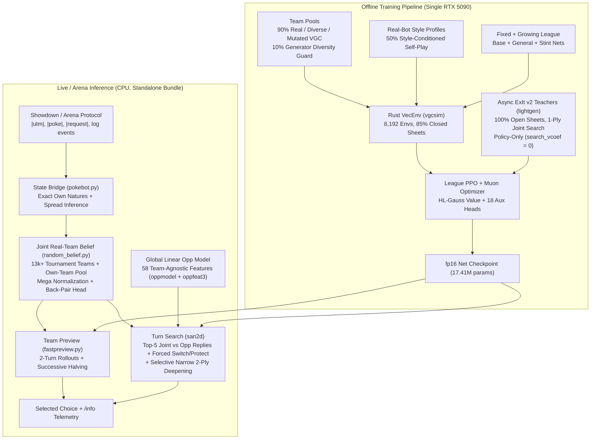

# MewsTruck VGC Bot — Technical Architecture & Training Guide

> **Target format:** Pokémon Champions VGC Doubles — Regulation M-C (`gen9championsvgc2026regmc`), 100% Closed Team Sheets (CTS), 4-of-6 Bring-6-Pick-4, Mega Evolution, stat-point system (32-point Champions spreads).  
> **Intended audience:** VGC bot developers, RL/search engineers, and AI assistants inspecting this architecture to understand how each subsystem works, how they fit together, and which plausible ideas failed empirical testing.

---

## 1. High-Level System Overview

MewsTruck is a **neural-guided search agent** built around four pillars:

1. **A custom Rust battle simulator (`vgcsim`)** exposed to Python via PyO3, running vectorized rollouts at **1,300–2,100 games/s** on a single RTX 5090 (8,192 parallel environments), exact 16-roll damage calculations, chance-node enumeration, and closed-sheet observation masking.
2. **A 17.41M-parameter entity-token Transformer (`TNet`)** trained via **League PPO + policy-only Expert Iteration v2 (ExIt v2)** for ~180M–240M+ games, outputting a factorized joint-action policy over both active slots (`38 × 38`), a 128-bin HL-Gauss distributional value head, a factorized opponent joint-action predictor, a 90-option team-preview head, and 18 auxiliary heads.
3. **A Bayesian closed-sheet belief & state-reconstruction bridge** that maps live Pokémon Showdown protocol streams into simulator states, infers exact own-team spreads from `|utm|`, estimates opponent hidden sets jointly against 13,000+ real tournament teams, predicts the opponent's unseen back pair from our own preview head, and tracks opponent spreads from observed damage and turn order.
4. **Lightweight play-time search tuned specifically for closed sheets:**
   - **Team preview (`fastpreview`):** Successive-halving 2-turn value-net rollouts across guessed opponent teams (~550–650 rollouts on CPU in ~18 s).
   - **Battle turns (`san2d`):** Predicted-mix light search over top-5 joint candidates vs top opponent replies (adjusted by a 58-feature linear global opponent model) + forced switch & Protect replies, regularized by the joint policy prior ($\beta = 20$), with **selective narrow 2-ply chance-node deepening** on contested turns.

---

## 2. Custom Rust Simulator (`vgcsim`) & Observation Encoding

### 2.1 Why a Custom Rust Engine
Training a VGC doubles network to 150M–240M+ games requires simulating tens of billions of turns. Running Pokémon Showdown (Node.js) directly is orders of magnitude too slow for RL rollouts and too slow for live play-time 2-ply chance-node search.

`vgcsim` is a faithful Rust implementation of Generation 9 Champions VGC Doubles mechanics (including Mega Evolution, Champions 32-point stat spreads, speed ties, Protect streaks, redirection, weather/terrain timers, Choice locks, Encore/Disable/Taunt, Fake Out, Intimidate, Emergency Exit, Illusion, Stamina, multi-hit moves, and exact 16-roll damage formulas), compiled as a native Python extension via `maturin` / PyO3.

Key simulator capabilities exposed directly to Python:
- **Vectorized self-play (`VecEnv` / `SplitVecEnv`):** Steps 8,192 battles in parallel across CPU threads with Rayon while the GPU runs batched neural inference (`--overlap` overlaps CPU stepping with GPU forward/backward passes).
- **Batched leaf evaluation (`search_leaves_bytes`):** Clones a position, runs `N_ours × N_theirs × N_dice` one-turn rollouts in parallel in Rust, and returns contiguous float32/int32 buffers ready for zero-copy PyTorch evaluation.
- **Chance-node expansion (`chance_leaf_battles`):** Enumerates important stochastic turn outcomes (crits, accuracy misses, speed ties, secondary status) down to a probability threshold (`min_path = 0.15`, capped at 3 children/cell for fast 2-ply) and returns child `Battle` objects with exact branch weights.
- **Exact `<= 2v2` endgame solver (`exact_root` / `eg_leaves`):** Alpha-beta / minimax equilibrium solver used during training to rescore endgame training targets (`--eg-rescore 20000`) and 1v1 tie-break probes (`--ovo-per-step 32`).
- **Exact damage calculator (`damage_rolls`):** Exposes exact 16-roll damage distributions for live opponent-model feature extraction and state encoding.

### 2.2 Action Space (`38` Actions per Active Slot)
Each active slot (`slot 0` and `slot 1`) has `N_ACT = 38` discrete action indices:

| Index range | Meaning |
|---|---|
| `0..31` | `move_slot * 8 + target_code * 2 + mega_flag` (`4` move slots × `4` target codes × `{no-mega, mega}`) |
| `32..35` | Switch to party slot `0..3` |
| `36` | Struggle |
| `37` | Pass (empty / fainted / forced-wait slot) |

Joint actions are pairs `(a, b) ∈ {0..37} × {0..37}`. Legal joint masks enforce doubles-specific joint constraints:
- Both slots cannot switch into the same bench Pokémon (`a == b` for `32 <= a < 36`).
- Both slots cannot Mega Evolve on the same turn.
- Both slots cannot simultaneously use identical global/side field moves (e.g., dual Tailwind, dual Trick Room, dual Reflect, dual Weather/Terrain).

### 2.3 Observation Encoding (`2,468` Floats + Integer IDs)
Each battle state is encoded from the acting player's perspective into a flat float vector (`obs_f`, dimension `2,468`) plus integer vocabulary IDs (`obs_i`, `8 × 7` IDs: species, ability, item, 4 moves):

| Slice | Offset | Size | Contents |
|---|---:|---:|---|
| **Brought Pokémon** | `0` | `8 × 80 = 640` | 4 own brought + 4 foe brought: present/active/slot one-hots, HP%, fainted, status, stat stages, types, base/computed stats, volatile flags, Protect streak, Choice lock, Mega state, move PP/power/type/category/accuracy/priority/revealed bits |
| **Field & Side State** | `640` | `40` | Turn number, weather + turns, terrain + turns, Trick Room / Gravity, both sides' Tailwind / Reflect / Light Screen / Aurora Veil / Safeguard / Misty / hazards, Mega-used flags |
| **Pairwise Damage Block** | `680` | `96` | Precomputed damage-roll features between active Pokémon (`OBS_T = 776`) |
| **Per-Mon Action History** | `776` | `8 × 20 = 160` | Last move used, target code, move result (hit/immune/blocked/failed), move usage counts (`HIST_F = 20`) |
| **Uncertainty Damage Block** | `936` | `68` | Expected damage features under hidden-set uncertainty, computed against Rust's `unc_library` (`VGCSIM_DMG_STATE=1`) |
| **Extended Damage Block** | `1004` | `8 × 68 = 544` | Per-Pokémon extended offensive/defensive matchup damage features (`EXT_F = 68`) |
| **Extra Roster / Preview Rows (`V3`)** | `1548` | `8 × 87 = 696` | Rows `0–1`: our 2 unbrought Pokémon; Rows `2–7`: opponent Pokémon not in brought rows `4–7` (open sheets: their 2 unbrought; closed sheets: unseen team-preview species with species/types/base stats) |
| **Visibility & Roster Flags** | `2244` | `16 × 4 = 64` | Per row across all 16 Pokémon rows: seen-by-opponent, unseen-candidate, known-at-home, duplicate base species |
| **External Belief Input (`BEL`)** | `2308` | `10 × 16 = 160` | Per opponent candidate row (`4` brought + `6` extra): present, exact-set flag, believed ability/item/4 moves IDs, believed stats `/ 300` (`OBS_BEL = 2468`) |

**Closed-sheet masking (`hidden=True`):** Unrevealed opponent moves, items, abilities, and spreads are masked to zero/unknown in the primary observation so the network never leaks hidden information. Meanwhile, the `UNC` damage block and optional `BEL` external belief slice supply honest, non-leaky priors (from real tournament teams during training via `--belief-mix 0.3,0.5`, and from `random_belief.py` at play time).

---

## 3. Neural Network Architecture (`TNet` — 17.41M Parameters)

`TNet` is an **entity-token Transformer** rather than a flat MLP, allowing permutation-equivariant reasoning across Pokémon, matchups, and targets.

### 3.1 Backbone & Embeddings
- **Parameter count:** `17,411,520` (~17.41M; ~34 MB exported in fp16).
- **Vocabularies & embedding sizes:**
  - `species`: `1,417 × 32`
  - `ability`: `322 × 16`
  - `item`: `584 × 16`
  - `move`: `852 × 24`
- **Entity tokens (`13` core tokens):** Each Pokémon row (`80` numeric + embeddings + `20` history + `68` ext damage + flags + external belief features) is projected into `d_model = 256`, alongside a `field` token and unseen roster summary tokens.
- **Transformer Encoder (`enc`):**
  - **16 layers**, `d_model = 256`, `ffn = 1024`, GELU activation, attention logit `softcap = 30.0`, `enc_opts = 15` (Pre-LN, QK-norm, type-chart attention bias `tb_lin`, and stabilized residual scaling).
- **Opponent Style Conditioning (`oc_proj`: `76 → 256`):** Projects an opponent behavioral style vector (or zero vector when anonymous/unconditioned) into the encoder context so the policy can condition on different opponent archetypes during training.
- **Action Decoders (`dec` and `odec`):**
  - 1-layer Transformer decoder (`dec`) attending from our active slot/action queries into the 13 encoded board tokens to produce per-slot logits `logits[2, 38]` and per-action embeddings.
  - Symmetric 1-layer opponent decoder (`odec`) predicting the opponent's per-slot logits `opp_logits[2, 38]` from our (potentially partial/closed-sheet) perspective.

### 3.2 Factorized Joint Policy Head & Opponent Joint Head
In VGC doubles, slot A and slot B choices are strongly coupled (e.g., Fake Out + Trick Room, Protect + Earthquake, switching one slot while covering the other, avoiding double-targeting a Protect). Treating the two slots as independent marginals (`log p(a, b) = log p(a) + log p(b)`) fails catastrophically on coordination turns.

Instead, `TNet` adds a **low-rank bilinear interaction head** (rank `32`, width `64` via `jt_a`, `jt_b`, `jt_mlp`, plus dedicated switch/Mega/other embeddings) producing an interaction matrix `inter ∈ ℝ^{38 × 38}`:

$$\log \pi(a, b) = \text{log\_softmax}_{(a,b) \in \mathcal{L}}\Big(\ell_0(a) + \ell_1(b) + \text{scale} \cdot \langle u_a, v_b \rangle\Big)$$

An identical head (`oj_a`, `oj_b`, `oj_mlp`, `oj_scale`) predicts the opponent's **joint** reply distribution `opp_inter ∈ ℝ^{38 × 38}`.

> **Measured impact (D-034):** Switching search priors from marginal product to the joint head gained **+8.7 percentage points** (`58.7%` vs old search, `z +3.0`).

### 3.3 HL-Gauss Distributional Value Head (`128` Bins)
Rather than regressing scalar win value `v ∈ [-1, 1]` with MSE or binary cross-entropy, the value head predicts a **128-bin categorical distribution** (`vbins = 128`) uniformly spanning `[-1.1, +1.1]`, trained via cross-entropy against a truncated Gaussian target centered at the return $y$ (Farebrother et al., 2024, arXiv:2403.03950):

$$p_k(y) \propto \Phi\!\left(\frac{e_{k+1} - y}{\sigma}\right) - \Phi\!\left(\frac{e_k - y}{\sigma}\right), \qquad \hat{v} = \text{clip}\!\left(\sum_{k=1}^{128} \hat{p}_k c_k,\ -1,\ 1\right)$$

> **Measured impact (D-033):** Beat MSE by **+0.7 pts** and plain sigmoid-CE by **+1.2 pts** in head-to-head play.

### 3.4 Team Preview Head (`pv_*`, 90 Options)
VGC Bring-6-Pick-4 has $\binom{6}{4} \times \binom{4}{2} = 90$ distinct `(4 brought, 2 leads)` plans. The preview head encodes all 12 Pokémon (6 own + 6 opponent) through the shared Pokémon encoder, applies contextual cross-team interaction (`pv_ctx`, `pv_cls`), and scores all 90 options efficiently via linear membership projections (`pv_w4`, `pv_w2`) plus **pairwise synergy heads** (`pv_pair_a/b` for bring-4 synergy, `pv_lead_a/b` for lead-2 synergy, rank `16`) and a matchup value head `pv_value`.

### 3.5 Auxiliary Heads (`18` Heads, `aux_share = 0.3`)
To accelerate representation learning—especially on closed sheets—the trunk is jointly trained on 18 auxiliary targets (`AUX_NAMES`), each normalized by its running loss mean so no single term dominates (`1/3` opponent-prediction slice, `2/3` game-state/dynamics slice):
- **Opponent actions:** `opp` (marginal), `oj` (joint), `onext` (next-turn opponent action).
- **Hidden-info belief:** `bel` (hidden opponent moves/items/abilities), `belx` (extended belief), `stat3` (opponent stat buckets), `mega` (Mega-stone possession).
- **Turn dynamics & outcomes:** `ko` (which slots faint this turn), `fut` (future HP/status), `fate` (survival/faint horizon), `margin` (final remaining-Pokémon margin), `short` (short-horizon return), `fnext` (next-turn field state), `leave` (switch-out prediction), `stage` (stat boosts), `pdmg` (predicted damage), `order` (move-order prediction), `ovo` (exact 1v1 endgame solver ground-truth probes).

### 3.6 Dropped Component: Cross-Turn Game Memory Frames
The checkpoint schema retains `mem_*` weights for compatibility, but **`mem_off = True`** (`--no-memory`). Controlled ablations showed 16-frame cross-turn attention memory changed fewer than 1% of decisions and gained only `+0.06–0.10 pts` even against styled opponents (D-037), because explicit per-Pokémon action history (`HIST_F = 20`) and revealed-state features already capture the relevant tactical history.

---

## 4. Training Pipeline: League PPO + Expert Iteration v2 (ExIt v2)

### 4.1 Base Reinforcement Learning Recipe (`train.py`)
Training runs on a single RTX 5090 (32 GB VRAM) with all inference and updates in mixed precision (`bf16` AMP, FP8 inference for rollouts via `--actor-fp8 --opp-fp8`, CUDA graphs `--graph-infer`, `torch.compile` on updates, THP disabled via `prctl(PR_SET_THP_DISABLE)` to prevent Linux memory-compaction stalls).

| Setting | Value | Rationale |
|---|---|---|
| Parallel envs | `8,192` | High throughput (~1,300–2,100 games/s) and low-variance PPO batches |
| Optimizer | **Muon** (`lr = 1.75e-4`, `muon_mult = 0.5`) | Constant LR; cutting LR caused premature plateaus (D-036) |
| Batching | `minibatch = 2,048`, `accum = 8`, `epochs = 1` | Large effective batch (`16,384`) for smooth updates |
| Discount / GAE | `gamma = 1.0`, `lam = 0.5` (policy), `lam_value = 0.8` (value) | Win/loss zero-sum episodes; lower policy $\lambda$ reduces credit-assignment noise in simultaneous-move doubles |
| Advantage filter | `--adv-filter 0.75 --adv-filter-keep 0.3` | Focuses policy gradients on decisive turns without zeroing out quiet turns |
| Loss stabilization | `--fixed-ce`, `kl-coef = 0.02`, `rkl = 0.002`, `pv-rkl = 0.001` | Fixed-denominator CE + anchor & reverse-KL prevent policy collapse |
| Opponent pool | `50%` fixed+stint league (`league-frac 0.5`), `30%` PFSP-hard past checkpoints (`past-frac 0.3`), `10%` anchor | Prevents cycling and preserves strength against diverse playstyles |
| Resign & Endgame | `--resign -0.94`, `--eg-rescore 20000`, `--ovo-per-step 32` | Ends dead games cleanly; replaces noisy 1v1/2v2 value targets with exact solver ground truth |
| Stat emulation | `--stat-emul 0.06` | Mild stat jitter during rollouts so policy isn't brittle to small EV/spread differences |

### 4.2 Dedicated Olympus Mons CTS Specialization (`deploy/om_cts_train.sh`)
Training directly for a closed-sheet real-team tournament ladder differs significantly from both fixed-team BYOT training (which over-specializes to a few sixes) and random-generator ladder training (which spends ~50% capacity on artificial generator fills):

- **Starting point:** `150.0M`-game general/CTS checkpoint (`random_s2.pt`), with both `random_s2.pt` and `general_s6a.pt` pinned permanently in the league alongside every new stint checkpoint.
- **Team distribution (`90%` real/diverse/mutated tournament teams):**
  - `40%` `Teams_real` (curated tournament VGC Reg M-C teams, train split only — **`Teams_real_test` is strictly held out and never touched during training or tuning**).
  - `25%` `Teams_div` (species-diverse tournament teams covering rarer Megas and archetypes).
  - `25%` `Teams_mut` (structurally mutated tournament teams mimicking Olympus Mons' `d >= 1.30` uniqueness-enforced submission pool).
  - `10%` `Teams_randgen` (small generator diversity guard).
- **Closed-sheet ratio:** `HIDDEN_FRAC = 0.85` (85% closed sheets, 15% open sheets to keep feature alignment and the open-sheet search teacher cleanly grounded), plus `15%` rare-scenario injection (`--scenario-frac 0.15`, `VGCSIM_SCEN_RARE=1`).
- **Real-bot style conditioning:** `--style-frac 0.5` samples opponent style profiles fitted from real competitive ladder bots (covering higher Fake Out, Speed control, Protect, and Mega usage and far lower double-Protect/switching than pure self-play).

### 4.3 Expert Iteration v2 (ExIt v2 — Policy-Only Open-Sheet Teacher)
Pure PPO in simultaneous-move doubles improves slowly on sharp 1-turn tactical calculations (exact KO ranges, Protect reads, double-targeting, Mega timing). **ExIt v2** pairs the PPO learner with 2 asynchronous background teacher workers (`lightgen.py`) sharing the same GPU:

1. Every 5 iterations (`--search-publish 5`), the learner publishes its latest weights to `search_net.pt`.
2. Background `lightgen` workers play **100% open-sheet games (`--hidden-frac 0.0 --open-only-labels`)** and run a fast 1-ply joint-pair search (`--joint-k 16`, `beta = 20`, 4 dice seeds) on every turn, writing `(obs, improved_joint_policy, search_value)` into a rolling 400k-position replay buffer.
3. The learner trains jointly on PPO batches plus ExIt batches (`--search-batch 256`, `--search-coef 1.0`) using **full joint-pair cross-entropy** (`--search-joint`) and **slot-0/slot-1 swap data augmentation** (`--search-augment`).

**Two critical empirical discoveries locked ExIt v2 (D-052):**
- **Open-only teacher labels (`--hidden-frac 0.0 --open-only-labels`):** Generating search labels on open-sheet games doubles label throughput and prevents closed-sheet oracle leakage (where a search teacher peaking at hidden sets teaches impossible reads). Remarkably, open-sheet search distillation transfers strongly to **closed-sheet** play (`+1.01 pts` on `Teams_real` CTS, `z +11.45`).
- **Policy-only distillation (`--search-vcoef 0`):** Adding search value distillation (`--search-vcoef 0.25 --search-v-hlg`) improved *raw* open-sheet play slightly (`+0.35–0.42%`) but **hurt search-guided play** (`48.95%` vs `vcoef = 0` under `san` search across 1,850 paired games, P 93% worse). Distilling 1-ply open-sheet search values subtly distorted the value head's calibration at search leaves. Turning value distillation off (`--search-vcoef 0`) kept leaf values cleanly calibrated and yielded gains that survived search:

| Stint | Total Games | Raw vs `random_s2` (`Teams_real` CTS) | Raw vs `random_s2` (`Teams_val_div` CTS) | `san2d` 2-Ply Closed Search h2h vs `random_s2` (`Teams_real`) |
|---|---:|---:|---:|---:|
| Stint 1 (`om_cts_s1`) | 165.0M | 52.30% ± 0.17 (`z +25.9`, P 100%) | 52.38% ± 0.17 (`z +26.8`, P 100%) | **52.00% ± 1.63** (`z +2.41`, P 99%, 1,473 pairs) |
| Stint 2 (`om_cts_s2`) | 180.0M | **52.84% ± 0.18** (`z +31.7`, P 100%) | **52.92% ± 0.18** (`z +32.6`, P 100%) | **54.13% ± 1.62** (`z +5.00`, P 100%, 1,442 pairs) |

*(Stints 3–6 continue at 15M games/stint on the same schedule.)*

---

## 5. Closed-Sheet State Bridge & Belief System

At inference time, the bot interacts over standard Showdown protocol streams (`poke-env` wrapped by a thin stdin/stdout driver `om_agent.py` with no network I/O).

### 5.1 Protocol-to-Engine Reconstruction (`pokebot.py`)
Every decision rebuilds a clean `vgcsim.Battle` snapshot from the live `poke-env` battle object and raw protocol log:
- **Exact own-team natures & spreads:** Parses the opening `|utm|<packed_team>` line *before* team preview fires (taking `line[5:]` so `|` fields stay intact), storing exact natures per species (`battle._own_natures`) with base-species fallback after Mega Evolution. Passes the exact nature into `infer_points()` so own-team stat points are never ambiguously guessed (especially critical after Mega Evolution).
- **Opponent spread & Speed tracking (`spread_infer.py`):** Updates posterior bounds on each observed opponent Pokémon's HP/Def/SpD/Atk/SpA/Spe from every observed damage roll (percentage deltas) and turn-order comparison.
- **Strict closed-sheet masking (`mark_revealed`):** Marks only moves, items, abilities, and forms actually observed in the battle log as revealed before calling `vgcsim.encode_battle(..., hidden=True)`, while keeping the full believed sets inside the simulator for rollout physics.

### 5.2 Joint Real-Team Opponent Belief (`random_belief.py`)
On closed team sheets, guessing each opponent Pokémon's moves/item/ability independently ignores strong team-level correlations (e.g., Pelipper + Archaludon implies Electro Shot / Leftovers or Assault Vest; Indeedee + Armarouge implies Expanding Force / Trick Room).

`random_belief.team_sets()` runs a **joint real-team Bayesian belief model** (`RANDOM_BELIEF_MODE="real"`, `RANDOM_BELIEF_GEN_W=1`, `NNBOT_UNC_RANDOM=0`):

1. **Candidate source teams:** Indexes 13,000+ real VGC tournament teams (`Teams_real` + `Teams_real_test`). Any real team sharing $k \ge 3$ species with the opponent's preview six is weighted by:
   $$w_i = \exp(\alpha k) \cdot \prod_{m \in \text{contradictions}} \text{MISFIT} \qquad (\alpha = 1.2,\ \text{MISFIT} = 0.15)$$
2. **Core + Fill posterior:** Each species' posterior mixes the weighted core sets from matching tournament teams (`CORE_P = 0.75`) with consistent fill sets from the real tournament pool + observed sets.
3. **Hard VGC legality constraints:** Sequential assignment (most-constrained / revealed species first) enforces **Item Clause** (no duplicate items), **at most 2 Mega stones**, and weather-setter consistency, while keeping Mega-stone-or-not fixed across sampled worlds so legal Mega action indices stay aligned.
4. **Mega-Evolution normalization:** Normalizes all 100 Mega-containing species (`_sp`, `_is_mega_form`, keeping `yanmega` and `meganium` intact and handling special forms like `meowsticmmega`, `tatsugiricurlymega`, `floetteeternalmega`). Crucially, once an opponent Pokémon Mega Evolves, its Mega ability (e.g., `Drought`, `Aerilate`, `Shadow Tag`, `Parental Bond`) is ignored when checking `_fits()` against base-form team sets, and revealed Mega Stones are also parsed directly from `|-mega|` log lines.
5. **Own-team pool recognition (`OM_OWN_TEAMS`):** On shared-pool ladders (like Olympus Mons, where opponents are sometimes dealt one of our own 20 submitted teams), if all 6 opponent preview species match one of our 20 teams and nothing revealed contradicts it, our exact sets + spreads receive `OWN_W = 0.97` probability mass (leaving 3% for the normal belief in case another entrant submitted the same 6 with different sets).

**Measured Turn-1 belief accuracy (0 moves revealed, `MODE=real` vs legacy `MODE=arena`):**

| Benchmark | Exact Set | Exact Item | Moves Right (of 4) |
|---|---:|---:|---:|
| 200 held-out real VGC teams (`Teams_val_div`, 1,190 mons) | 24.5% → **47.1%** (+22.6%) | 57.6% → **72.0%** (+14.4%) | 2.78 → **3.17** |
| 200 OM-style `d >= 1.30` mutated teams (1,200 mons) | 26.1% → **34.1%** (+8.0%) | 58.8% → **62.6%** (+3.8%) | 3.00 → **3.13** |

### 5.3 Unseen Back-Pair Prediction (`BACK_BROUGHT_HEAD = 1`)
At team preview, the opponent has 6 Pokémon and leads 2, leaving $\binom{4}{2} = 6$ possible unseen back pairs (uniform guess = 16.7% accuracy). We run **our own network's preview head from the opponent's seat** on our best `random_belief` / `OM_OWN_TEAMS` guess of their 6 sets (`hidden=True` on our side so they only see our 6 species), storing `battle._their_plan`. Every search world samples their 2 unseen back Pokémon from the conditional distribution given their observed leads.

> **Audit accuracy:** The most likely predicted back pair matched the opponent's true back pair in **55%** of closed random games and **67%** of closed own-team games (vs 16.7% uniform).

---

## 6. Team Preview Search (`fastpreview.py`)

We tested distilling rollout-preview choices back into the 287k-parameter preview head (`distill_preview.py`, 20,480 labels on frozen trunk); it gained only **+0.05 pts** across 496k test games (D-051). Live rollout simulation at team preview remains far stronger.

**How `fastpreview.choose()` works on closed sheets:**
1. Samples `K = 4` guessed full versions of the opponent's 6-Pokémon team from `random_belief.team_sets()` (world 0 = MAP guess; worlds 1–3 = joint draws), **deduplicating identical team texts** so own-team hits (`OM_OWN_TEAMS`) concentrate 100% of the rollout budget on the single exact team instead of splitting 4 ways.
2. Takes our top `k_ours = 16` plans from the preview head and the opponent's top `k_theirs = 8` plausible plans (softmax temperature `3.0`).
3. Runs **3-stage successive halving** of **2-turn self-play rollouts** (both sides sampled from the joint policy head, cut off after 2 full turns and judged by the value net, or exact terminal result if the game ended early).
   - A 2-turn rollout costs ~6 network rows vs ~17 for a full game and has much lower variance than binary win/loss.
   - Budgeted by `NNBOT_FAST_PV_ROWS = 24000` rows, `NNBOT_FAST_PV_ENVS = 96`, and a hard wall-clock deadline `NNBOT_FAST_PV_SECONDS = 18` s (~550–650 rollouts on desktop CPU, faster on Apple M-series).
4. Updates `battle._their_plan` directly from `sess[0].lg_b` (computed with `random_belief` / `OM_OWN_TEAMS` sets) so in-game back-pair sampling benefits from the upgraded belief.

---

## 7. Turn-by-Turn Search (`san2d`: Light Predicted-Mix Search + Selective Narrow 2-Ply)

### 7.1 Why Light Predicted-Mix Search Beat Heavy Equilibrium Search
In simultaneous-move imperfect-information games, heavy Nash/MCTS search over a single imperfect belief often **underperforms** a lightweight predicted-mix check:
- Computing a minimax equilibrium assumes an omniscient worst-case opponent who exploits every bluff; against real bots/humans, that causes overly passive/paranoid play.
- Searching 12–18 low-prior candidates chases value-net noise on noisy closed-sheet leaves.

Our ceiling study (D-043, D-047) and search ablations proved that **small candidate sets + joint-head prior regularization + realistic opponent-reply modeling + targeted 2-ply lookahead** consistently outperform heavier search on closed sheets.

### 7.2 Exact `san2d` Algorithm (`nnbot.py`)
On every non-forced-switch battle turn:

1. **Candidate generation:** Take `cands[0]` (the joint head's top legal pair) plus the next `SANITY_K = 4` highest-logit legal joint pairs (`5` candidates total).
2. **Opponent reply set (`theirs`):**
   - Run `sh_search.root_full()` on the filled position to get opponent marginal logits `ol` and joint interaction `oj`.
   - Apply the **global linear opponent model** (`oppmodel.adjust_fn`, Section 8) to adjust `ol` with blend weight `w_om`.
   - Take the top `SANITY_THEIRS = 3` joint opponent replies.
   - **Force-include switches (`_sanity_switch_replies`):** Append a reply for every legal opponent switch-in not already covered, with probability floor `0.04`.
   - **Force-include Protects (`_sanity_protect_replies`, `SANITY_PROTECT=1`):** Append a reply for each active opponent slot with a Protect-family move (`marginal >= 0.03`) not already Protecting, with probability floor `0.03`.
   - Blend opponent-model probabilities with raw head probabilities: $p_t = (1 - w_{\text{om}}) p_{\text{head}} + w_{\text{om}} p_{\text{model}}$, apply floors, and renormalize.
3. **Ply-1 rollout evaluation:** Run `NNBOT_SANITY_SEEDS = 8` dice seeds per `(our, their)` cell in Rust (`sh_search.leaves`), producing matrix `V1[5, |theirs|]` and expected values `q1 = V1 @ pt`.
4. **Prior-regularized scoring & `QRATIO` blunder guard (`_sanity_prior_pick`):**
   $$\text{score}(a) = \log \pi_{\text{joint}}(a) + \beta \cdot \min\!\big(q(a),\ 0.96\big) \qquad (\beta = 20)$$
   - The `0.96` win cap stops search from chasing meaningless `+0.002` value noise in already-won positions.
   - **QRATIO guard:** When winning (`max(q) > 0.5`), any candidate whose value is `> 0.06` below best *and* whose loss rate `(1 - q)` is `> 2.5×` the best candidate's loss rate (`max(1 - q_best, 0.02)`) is masked to `-1e9`.
5. **Selective Narrow 2-Ply Deepening (`_sanity_deep2`, `SANITY_DEEP2=1`):**
   - **Skip gate:** Skip if the position is already decided (`|max(q1)| >= 0.92`) or the top move already dominates cleanly (`score[0] - score[1] >= 2.5` and `|q1[0] - q1[1]| >= 0.14`).
   - **Expansion:** Select our top `3` candidates by ply-1 score and the opponent's top `3` replies by `pt` (`3 × 3 = 9` cells). Call `eb.chance_leaf_battles(..., min_path=0.15, max_children=3)` to enumerate major turn-1 outcomes.
   - **Batched ply-2 solve:**
     - Run **one batched forward pass** over all active non-terminal ply-2 children to get ply-2 joint candidates (top `3`) and ply-2 opponent replies (top `3`).
     - Run `search_leaves_bytes(..., worlds=2)` across all ply-2 children and evaluate all ply-2 leaves + switch-phase static children in **one single value-net batch**.
     - Score each ply-2 child using the exact same `log(pi) + 20 * min(q2, 0.96)` + `QRATIO` guard.
   - **Value backup:** Blend each expanded cell's chance-weighted 2-ply value (with residual probability `1 - wsum` backed up from `V1[o, t]`) back into `V_new`, recompute `q = V_new @ pt`, and pick via `_sanity_prior_pick`.

**Empirical search benchmark (`random_s2.pt`, 100% closed `Teams_real`):**
- `san2d` vs `san`: **51.53% ± 1.60** (`z +1.87`, **P 97%**, 1,210 pairs; 0.07 vs 0.04 s/dec GPU; ~0.5–3.5 s/dec desktop CPU).
- Pooled across Tests 1 + 4 + 5 (8,747 pairs), narrow 2-ply adds **~+0.83 pts (`z ≈ +2.85`, P 99.8%)**.
- Exact `<= 2v2` endgame solver (`san2d_eg`) on closed world 0 **lost 49.12% ± 0.67 (`z -2.57`, P 1%)** vs `san2d` -> **explicitly disabled (`NNBOT_ENDGAME=0`) on closed sheets.**

---

## 8. Global Linear Opponent Model (`oppmodel.py` + `oppfeat3.py`)

Self-play-trained opponent heads systematically mispredict how real VGC bots and humans play. Across 19,211 recorded decisions from top ladder bots, real bots consistently play:
- **More Fake Out** (`+0.65` to `+1.12` log-odds vs self-play head)
- **More Speed control** (`+0.57` to `+0.69`: Tailwind, Trick Room, Icy Wind, Electroweb)
- **More Protect** (`+0.25` to `+0.56`) and **more Mega Evolution** (`+0.18` to `+0.76`)
- **Far fewer double-Protects** (`-0.84` to `-1.56`) and **fewer raw switches** (`-0.14` to `-0.60`)

To capture these structural patterns without overfitting to specific teams or accounts (Olympus Mons opponents are anonymous `"Agent A"` / `"Agent B"`), `oppmodel.py` fits a regularized **linear logit correction** per battle phase (`turn 1`, `mid-game`, `endgame <= 2 mons`):

$$\ell'_{\text{opp}}(a) = \exp(s + s_{\text{phase}}) \cdot \ell_{\text{head}}(a) + (w + w_{\text{phase}}) \cdot x(a)$$

- **58 team-agnostic features (`oppfeat3.py` + `oppmodel.py`):** Protect / Protect-again / Mega-Protect / Protect-late / Protect-T1, switch safety (`sw_safe`, `sw_safest`, `sw_unseen`, `sw_threatened`, `switch_t1`), status sub-categories (setup, screen, redirect, disrupt, heal), ally support vs attack, exact damage/speed KO features (`ko_acc`, `ko_first`, `danger2_protect/switch/attack`), Fake Out & Fake Out on biggest threat, Speed control & active-SC guard, targeting low-HP / focus / into-Protect, plus in-game transitions/habits and population matchup priors (`feat6["*"]`).
- **Deployment (`om/slim_oppmodel.py`):** Strips all per-account tables while preserving the global weights, phase offsets, population matchup table, and decision count so anonymous matches receive the calibrated global correction.
- **Regularization philosophy:** The neural network itself (`om_cts`) is **never** fine-tuned on old replays (avoiding stale-meta overfitting). Only the linear global model is refit for the final checkpoint on all real-bot games (with at most a mild 2x upweight on top confirmed tournament rivals, gated on held-out NLL/top-1 across *both* those rivals and the rest of the field), blended at a moderate `NNBOT_OPPMODEL_W = 0.55–0.60`.

---

## 9. Team Generation, Uniqueness Filtering & 20-Team Portfolio Selection

Olympus Mons requires submitting **20 distinct teams**, each having structural distance $d \ge 1.30$ against both a 10,000+ team public blocklist and every other team in the 20-team submission.

1. **Seed sourcing:** Combines top-performing curated Reg M-C tournament teams with our strongest internally discovered BYOT archetypes (e.g., Rain/Archaludon, Floette-Eternal, Protect/bulky balance cores).
2. **Variant generation & official checking:** Generates hundreds of playable single/multi-slot mutations (moves, items, spreads, complementary partners) and filters strictly with the arena's exact uniqueness checker (`om_check.ts`, $d \ge 1.30$ against the full blocklist).
3. **Closed-sheet neural grading:** Grades every passing candidate on 100% closed sheets using our final `om_cts` network against a diverse competitive field (`Teams_real` validation / field pool).
4. **Distinct portfolio pick (`om_pick.ts`):** Greedily / combinatorially selects 20 high-win-rate teams that all satisfy pairwise $d \ge 1.30$, then packages those exact 20 teams inside `src/om_teams/` for own-team belief recognition (`OM_OWN_TEAMS`).

---

## 10. Evaluation Rigor & Negative Results ("What Didn't Work")

### 10.1 Evaluation Discipline
- **Mirrored paired testing:** Every head-to-head plays each `(team A, team B, seed)` **twice** with seats swapped, scored exclusively by a single unit-tested scorer (`spine/h2h_score.py`) reporting win share, ±1.96 SE, won-both/split/lost-both counts, $z$-score, and $P(A > B)$.
- **Ceilings first (D-047):** Before investing days in an idea, we measure its **oracle ceiling** (giving search the ground-truth answer). If the oracle ceiling is small, we drop the idea immediately.
- **Strict holdout hygiene:** `Teams_real_test` is reserved exclusively for final one-shot confirmation—never used for training, checkpoint selection, or hyperparameter tuning.

### 10.2 Ideas Tested & Rejected (Save Yourself Weeks!)

| Idea | Measured Result | Why We Dropped It |
|---|---|---|
| **ExIt v2 with value distillation (`--search-vcoef 0.25`)** | `48.95%` vs `vcoef=0` under `san` search (1,850 pairs, P 93% worse) | Improved raw OTS slightly but miscalibrated value-head leaves under search (D-052). |
| **Offline / online preview-head teacher (`pvgen` / `distill_preview`)** | Online `-0.96 pts`; offline frozen-trunk `+0.05 pts` (496k pairs) | Small 287k-param preview readout on a frozen trunk can't memorize what 15k-row rollouts discover (D-051). |
| **2-ply ExIt teacher (`lightgen --deep2`)** | `-0.30 pts` CTS, `-0.10` pooled | 38% fewer labels at fixed GPU budget; fast 1-ply teacher beats slow 2-ply teacher. |
| **Exact `<= 2v2` endgame solver on closed sheets (`san2d_eg`)** | `49.12% ± 0.67` (`z -2.57`, **P 1%**) vs `san2d` | Brittle minimax equilibrium on single guessed world 0 gets blown out when opponent hidden moves/items/Speed differ. |
| **Closed-sheet search gate (`closed_gate=True`)** | `46.0%` on closed sheets | Skipping light search when `> 2` foes are alive throws away huge tactical saves. |
| **Force-Protect + prior-beta without 2-ply (`san2n`)** | `49.39%` (1,712 pairs, P 16%) | Needed selective 2-ply (`san2d`) to realize gains (`51.53%`, P 97%). |
| **Wider / always-on / 4-dice 2-ply (`san_d2w`, `san_d2a`, `san_d2s4`)** | No gain over narrow selective 2-ply (`3×3`, 2 dice) at 2–3× cost | Extra breadth adds leaf noise and burns CPU clock. |
| **Mismatched multi-world (`san2d_w3`: 3-world ply-1 + 1-world ply-2)** | `48.40%` (P 5%) | Scale/variance mismatch between world-0 deepened cells and 3-world non-deepened cells. |
| **Cross-turn game memory frames (16 frames)** | `+0.06–0.10 pts` (<1% games changed) | Explicit per-mon history features already capture tactical state (D-037). |
| **Per-opponent specialized neural nets & supervised replay fine-tuning** | Better offline NLL, `~0` live search gain | Small replay sets overfit to old teams/spreads without improving search decisions (D-035, D-041). |
| **LR annealing / cuts during RL** | Plateaued early; raising LR back gained `+3.1–3.3 pts` | Constant LR (`1.75e-4` Muon) sustains steady climbing (D-036). |
| **Marginal-product search prior (`p(a) * p(b)`)** | Lost `-8.7 pts` to joint-head prior | Doubles coordination requires the explicit `38 × 38` joint interaction head (D-034). |

---

## 11. Packaging, Protocol & CI Verification (Standalone `darwin/arm64` Bundle)

For arena deployment (`pkmn.ai`), the bot ships as a self-contained, read-only, offline `darwin/arm64` `.tar.zst` archive (`<= 500 MiB` unpacked and compressed, `<= 25,000` entries):

- **Entrypoint (`./run` → `om_agent.py`):**
  - Pre-warms all libraries, 13k+ real teams, own-team pool, `vgcsim` world sets, and fp16 policy/preview nets **before** emitting `/ready` (`~9 s` vs `60 s` budget).
  - Enforces strict protocol hygiene: `sys.stdout` is redirected to `stderr` so *only* `/ready`, `/info <JSON>`, and single bare choice lines (`team 1234`, `move 1 2, switch 3`) ever touch `stdout`.
  - Emits `/info {"win": ..., "policy": {...}}` on every decision (including preview, search, policy, and fallback paths) for 100% `"full"` telemetry coverage.
  - Arms an async watchdog timer parsed from `|inactive|Time left: ...` (`margin = 15 s`) that sends `default` if any decision ever hangs, dropping any late duplicate answer.
  - Writes strictly to `$TMPDIR` (never mutating the read-only bundle).
- **CI build (`macos-26` GitHub Actions):**
  - Packages standalone Python 3.12 + pruned PyTorch (each pruned directory import-verified; `sympy`/`mpmath` kept for Torch attention checks) + `maturin --release` compiled `vgcsim` wheel + zipped stdlib + `strip -x` + ad-hoc `codesign`.
  - Exports weights to fp16 (`om/fp16_net.py`, verified mean `KL < 1e-5` and `>= 99%` top-action agreement).
  - Runs a **read-only end-to-end smoke game** with the arena's own protocol parser (`om_harness.ts` + `@pkmn/sim`), failing the build if:
    - `/ready` exceeds `60 s` or any invalid choice occurs
    - `/info` status is not `"full"`
    - Own-team recognition fails to fire
    - Any Python `Traceback` appears in stderr or `$TMPDIR/bridge_errors.txt` is non-empty
    - The global opponent model fails to fire (`om_w == 0` in `$TMPDIR/sanity.jsonl`)
    - Unpacked size exceeds `500 MiB` or entry count exceeds `25,000`
